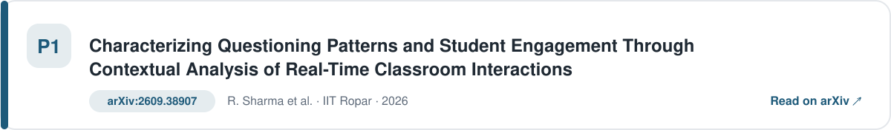
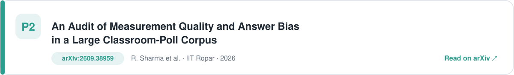

  

  

  
  
  
  

  

<picture><source media="(prefers-color-scheme: dark)" srcset="assets/h-about-dark.svg" /></picture>

  

<picture><source media="(prefers-color-scheme: dark)" srcset="assets/h-projects-dark.svg" /></picture>

  
  

  
  

<picture><source media="(prefers-color-scheme: dark)" srcset="assets/h-research-dark.svg" /></picture>

  

  

  

<picture><source media="(prefers-color-scheme: dark)" srcset="assets/h-stack-dark.svg" /></picture>

  

<picture><source media="(prefers-color-scheme: dark)" srcset="assets/h-activity-dark.svg" /></picture>

  

  

